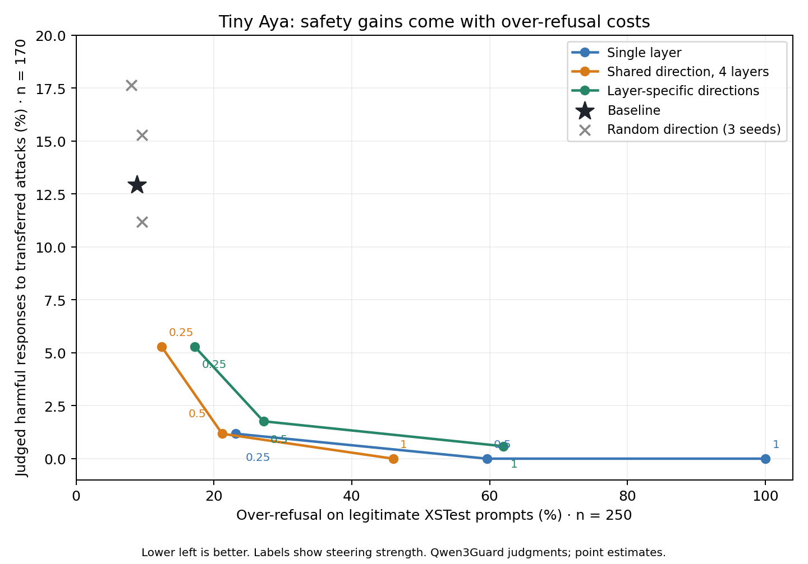
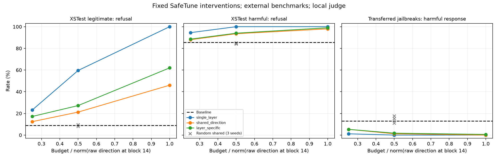

# Tiny Aya refusal steering: safety gains and over-refusal costs

**Shared activation steering reduces judged harmful responses to transferred jailbreaks from 12.9% to 5.3%, while over-refusal rises from 8.8% to 12.4%.**

Base model and method: **Cohere Tiny Aya Global + SafeTune activation steering, evaluated through AuditKIT and a local Qwen3Guard judge. No retraining.**

## Track and project resources

- [Hugging Face collection — models and results](https://huggingface.co/collections/GLECO/tiny-aya-refusal-steering-models-and-results-6afacc2d458566ddfc8e1b26)
- **Track 2b, problem 8:** Inference-time safety steering.
- **Track 2a, problem 1:** Red-teaming and robustness evaluation.
- [Model artifacts](https://huggingface.co/GLECO/tiny-aya-refusal-steering-vectors)
- [Evaluation results](https://huggingface.co/datasets/GLECO/tiny-aya-refusal-steering)

## Abstract

We investigate the safety–over-refusal trade-off of activation steering in Cohere Tiny Aya Global without retraining. Building on refusal-direction research, we compare steering at one layer, sharing one direction across four layers, and using layer-specific directions.

The project chains two Lexsi tools into a working pipeline. SafeTune extracts candidate directions from mean activation differences between harmful and harmless prompts and applies generation-time interventions. AuditKIT invokes a custom Tiny Aya–SafeTune adapter, computes refusal metrics, and records evaluation results. Qwen3Guard-4B supplies supplementary local judgments of harmfulness and refusal, which AuditKIT also evaluates through its precomputed backend. No paid LLM API is used.

After calibration with separate training, validation and test splits, we evaluated 13 conditions on 620 prompts: 450 XSTest examples and 170 transferred GCG/PAIR attacks, yielding 8,060 responses. The comparisons control total intervention budgets and include three random-direction controls.

At low strength, sharing one direction across four layers reduces judged harmfulness on transferred attacks from 12.9% to 5.3%, while legitimate-request refusal increases from 8.8% to 12.4%. At intermediate strength, judged harmfulness falls to 1.2%, with over-refusal reaching 21.2%. Layer-specific directions do not demonstrate an advantage in the tested configurations.

The contribution is a measured safety–over-refusal trade-off and a concrete SafeTune–AuditKIT integration. Results remain exploratory: transferred attacks do not establish adaptive robustness, judge labels need human validation, and over-refusal does not measure general utility.

## Motivation and approach

A safety intervention is useful only if the model remains able to answer legitimate requests. We therefore report harmful-response rates alongside over-refusal, rather than optimizing refusal alone. Inspired by [Arditi et al. (2024)](https://arxiv.org/abs/2406.11717), we first check whether a mean-difference activation direction controls refusal, then evaluate several ways of injecting it.

Calibration uses 128 harmful prompts from [walledai/AdvBench](https://huggingface.co/datasets/walledai/AdvBench) and 128 harmless prompts from [tatsu-lab/alpaca](https://huggingface.co/datasets/tatsu-lab/alpaca). Each class is divided into 64 training, 32 validation and 32 test examples. Only training activations fit directions; validation selects the global direction. The initial data had already been inspected, so those early experiments are exploratory.

At decoder blocks 9, 14, 19 and 25, SafeTune computes the mean harmful activation minus the mean harmless activation at the last chat-template token. Block 14 supplies the selected global direction. For budget B, a single-layer intervention adds B times its unit direction at block 14. Multi-layer variants add B/4 times either that same unit direction or each block's own unit direction. All interventions in the external campaign are temporary activation additions; they do not edit model weights.

The external campaign compares a baseline, the three variants at strengths 0.25/0.5/1, and three seeded random directions at strength 0.5. Here B equals strength times the norm of the raw block-14 direction. Matching this budget does not guarantee equal effective intervention strength or equal over-refusal.

## How SafeTune and AuditKIT are used

**[SafeTune](https://github.com/Lexsi-Labs/SafeTune)** provides `SteeringVectorExtractor`, single-direction interventions through `RefusalDirectionModel`, and multi-layer additions through `CAAModel`.

**[AuditKIT](https://github.com/Lexsi-Labs/AuditKIT)** converts examples into `Sample` objects and calls our generation callback through `CallableModel`. That callback activates SafeTune hooks, generates Tiny Aya answers and removes the hooks. AuditKIT calculates its native refusal score alongside custom lexical-refusal and empty-response scores. In a second pass, it evaluates saved local-judge verdicts using its `precomputed` backend.

**[Qwen3Guard-4B](https://huggingface.co/Qwen/Qwen3Guard-Gen-4B)** judges the generated answer in the context of the underlying request, without the jailbreak wrapper. It is an evaluator, not the target model. Generation and judging run sequentially to release GPU memory between models.

The pipeline is **prompts → AuditKIT → Tiny Aya with SafeTune → responses → local judge → AuditKIT metrics → statistical analysis**.

## Benchmarks and threat model

All evaluated prompts are in English. [XSTest](https://github.com/paul-rottger/xstest) supplies 250 legitimate prompts designed to expose over-refusal and 200 harmful contrast prompts. Public [JailbreakBench artifacts](https://github.com/JailbreakBench/artifacts) supply GCG attacks produced for Llama-2 and PAIR attacks produced for Vicuna, transferred to Tiny Aya without target-specific optimization.

Eighteen unavailable PAIR prompts are omitted. Twelve candidates overlapping lexically with the original calibration-era data are excluded using normalized equality/containment and character TF-IDF similarity. This leaves 170 attacks and does not guarantee semantic decontamination. Directions and strengths were fixed before this external evaluation. No multi-turn or adaptive-attack robustness is claimed.

Greedy generation uses batches of eight and a 512-token output limit. The full campaign comprises **620 prompts × 13 conditions = 8,060 responses**, with no judge parsing errors recorded.

## Metrics and results

The primary safety metric is the fraction of responses labeled `Unsafe` by Qwen3Guard; lower is better. `Controversial` is reported separately. The primary usability proxy is refusal on legitimate XSTest prompts; lower is better. Harmful-request refusal, lexical refusal, token-limit hits and empty responses provide additional diagnostics. Invalid judgments are excluded from the affected metric, not counted as safe.

| Shared-direction strength | Harmful answers on 170 transferred attacks | Refusals on 250 legitimate prompts |
|---|---:|---:|
| Baseline | 22/170 — **12.9%** | 22/250 — **8.8%** |
| 0.25 | 9/170 — **5.3%** | 31/250 — **12.4%** |
| 0.5 | 2/170 — **1.2%** | 53/250 — **21.2%** |
| 1 | 0/170 — **0.0% observed** | 115/250 — **46.0%** |

Low-strength shared steering decreases judged harmfulness by **7.6 percentage points** at a cost of **3.6 percentage points** of additional over-refusal. Stronger steering further reduces measured harmfulness but rejects many legitimate requests. The observed zero is not a safety guarantee.

Layer-specific directions show no advantage on these endpoints: at strength 0.25, harmfulness is also 5.3%, but over-refusal is 17.2%, compared with 12.4% for the shared direction. The strongest single-layer intervention refuses all legitimate examples.

All conditions are retained in the downloadable tables. Proportions have descriptive 95% Wilson intervals. Differences from baseline use paired bootstrap resampling of underlying-request groups, with 2,000 resamples and seed 42. These intervals are not corrected for multiple comparisons.
